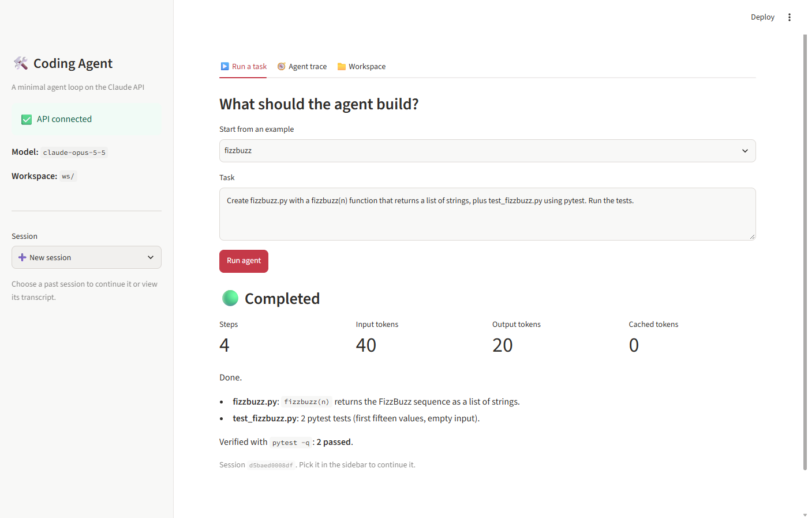
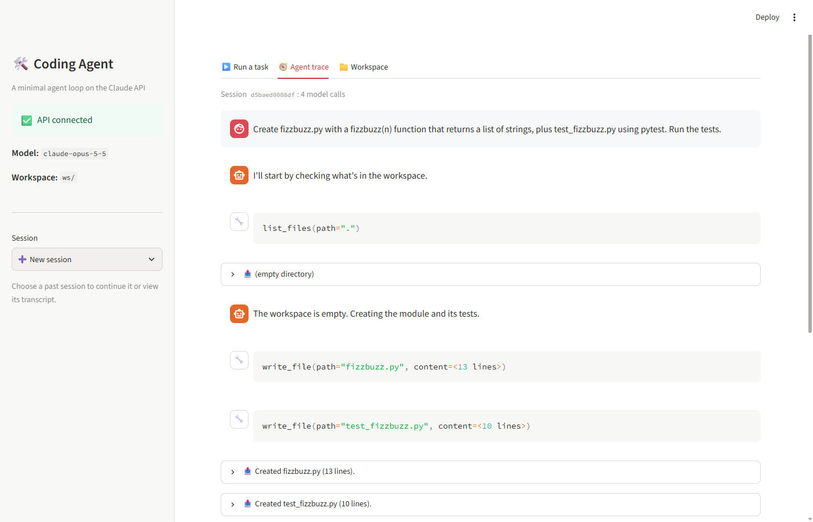
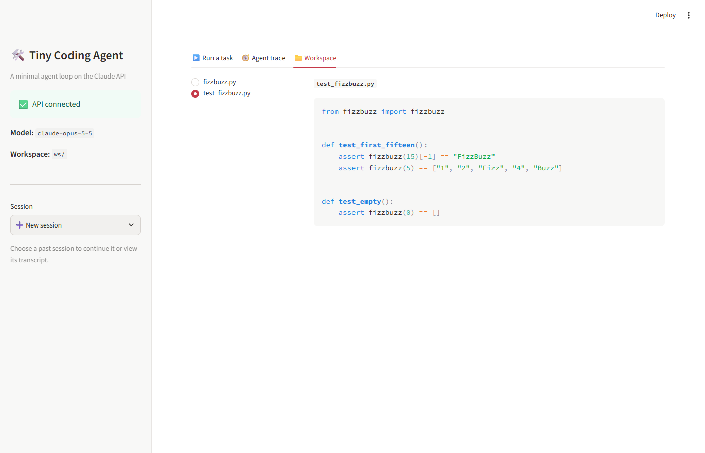

# 01 · Coding Agent

A small, readable coding agent served as a **FastAPI** application. Give it a task like
*"add fizzbuzz.py with tests and run them"* and it reads, writes, searches and runs code
inside a sandboxed workspace folder until the task is done.

The goal is to show the core of every coding agent (Claude Code, Cursor, Aider…) in a
few hundred lines: **model → tool calls → results → model → … → done**.


<sub>Demo recorded against a scripted model so it is reproducible without an API key. The UI, API, tools and workspace are the real ones, and the `pytest` run was executed for real.</sub>

| Run a task | Agent trace | Workspace |
|---|---|---|
|  |  |  |

## Features

- **Hand-written agent loop** using the Claude API (`claude-opus-5-5`, adaptive thinking).
- **6 tools:** `list_files`, `read_file`, `write_file`, `edit_file` (exact-match replace),
  `search_code` (regex), `run_command` (shell).
- **Sandboxed workspace:** every path is resolved inside `workspace/`, so `../` escapes are rejected.
- **Human approval** before shell commands in the CLI. In the API they are off unless you enable them.
- **Strict tool schemas** (`strict: true`) so tool inputs always match the schema.
- **Prompt caching** of the growing conversation, which cuts cost on long loops.
- **Refusal fallback:** if the model declines a request, the API retries it on a fallback model.
- **Session memory:** conversations are saved as JSON and can be resumed by `session_id`.
- **Robust stop handling:** `tool_use`, `end_turn`, `max_tokens` (truncated tool calls are
  reported back rather than run), `pause_turn`, `refusal`, and a step limit.
- **Streamlit UI:** run tasks, step through the agent's trace (every tool call and result),
  and browse the files it wrote.
- **Offline test suite** with a scripted fake LLM, so no API key is needed for tests.

## Project structure

```
01-coding-agent/
├── README.md
├── requirements.txt
├── .env.example            # copy to .env (never commit .env)
├── .gitignore
├── Dockerfile
├── docker-compose.yml
├── main.py                 # FastAPI app (`main:app`) + optional terminal CLI
├── ui/
│   └── app.py              # Streamlit front end (calls the FastAPI backend)
├── docs/                   # demo.gif + screenshots for this README
├── src/
│   ├── agent/
│   │   ├── agent.py        # the agent loop
│   │   ├── executor.py     # runs tool calls -> tool_result blocks, approval gate
│   │   ├── state.py        # conversation state, token usage, results
│   │   └── memory.py       # save / resume sessions as JSON
│   ├── tools/
│   │   ├── base.py         # Tool, ToolError, sandboxed Workspace
│   │   ├── filesystem.py   # list / read / write / edit
│   │   ├── search.py       # regex code search
│   │   └── shell.py        # run_command (needs approval)
│   ├── models/
│   │   └── llm_client.py   # Anthropic SDK wrapper (model, effort, caching, fallback)
│   ├── prompts/
│   │   ├── system_prompts.py
│   │   └── agent_prompts.py  # system prompt + knowledge base assembly
│   ├── utils/
│   │   ├── config.py       # settings from env / .env
│   │   ├── logger.py       # console + rotating file logs
│   │   └── helpers.py      # truncation, serialization
│   └── api/
│       ├── routes.py       # FastAPI endpoints
│       └── schemas.py      # Pydantic request/response models
├── tests/                  # test_agent.py, test_tools.py, test_api.py (offline)
├── data/
│   ├── examples.json       # sample tasks
│   └── knowledge_base/     # *.md conventions injected into the system prompt
├── logs/                   # agent.log
└── workspace/              # the only folder the agent can touch
```

## Setup

```bash
cd 01-coding-agent
python -m venv .venv
# Windows: .venv\Scripts\activate   |   macOS/Linux: source .venv/bin/activate
pip install -r requirements.txt
cp .env.example .env              # then put your ANTHROPIC_API_KEY in .env
```

## Run the API

```bash
uvicorn main:app --reload         # or: python main.py
```

Open http://localhost:8000/docs for the interactive Swagger UI.

| Method | Path                     | Description                                       |
|--------|--------------------------|---------------------------------------------------|
| GET    | `/health`                | Status, model and workspace path                  |
| POST   | `/run`                   | Run a task: `{"task": "...", "session_id": null}` |
| GET    | `/sessions`              | List saved session ids                            |
| GET    | `/sessions/{id}`         | Full transcript (messages, tool calls, results)   |
| GET    | `/workspace/files`       | Files currently in the workspace                  |
| GET    | `/workspace/file?path=…` | Contents of one workspace file                    |

```bash
curl -X POST localhost:8000/run -H "Content-Type: application/json" \
  -d '{"task": "Create fizzbuzz.py with a fizzbuzz(n) function and tests"}'
```

Example response:

```json
{
  "status": "completed",
  "final_text": "Created fizzbuzz.py and test_fizzbuzz.py ...",
  "steps": 4,
  "session_id": "3f9c1a2b7d4e",
  "usage": {"input_tokens": 5120, "output_tokens": 830, "cache_read_input_tokens": 3900, "cache_creation_input_tokens": 1100}
}
```

Pass the returned `session_id` in the next request to continue the same conversation.

> **Shell commands over the API:** no one is there to approve them, so `run_command` is declined
> unless `AGENT_AUTO_APPROVE=true`. Only enable it for a disposable workspace (for example, the
> Docker setup below, which mounts only `workspace/`).

## Run the Streamlit UI

With the API running, open a second terminal:

```bash
streamlit run ui/app.py           # http://localhost:8501
```

Set `AGENT_API_URL` if the API is not on `http://localhost:8000`.

## Use it from the terminal (optional)

```bash
python main.py cli "Create fizzbuzz.py with tests and run them"
python main.py cli                       # interactive chat
python main.py cli --session <id> "now add type hints"
python main.py cli --workspace ../some-project "explain this codebase"
```

The CLI asks before every shell command (`--yes` skips the prompt).

## Docker

```bash
docker compose up --build         # API on :8000, UI on :8501
```

## Tests

```bash
pytest -q
```

## Configuration

All settings come from environment variables; see `.env.example`.

| Variable                | Default           | Meaning                                     |
|-------------------------|-------------------|---------------------------------------------|
| `AGENT_MODEL`           | `claude-opus-5-5` | Claude model id                             |
| `AGENT_EFFORT`          | `high`            | Thinking depth: `low` … `max`               |
| `AGENT_MAX_STEPS`       | `30`              | Max model calls per task                    |
| `AGENT_WORKSPACE`       | `./workspace`     | Sandbox folder                              |
| `AGENT_COMMAND_TIMEOUT` | `60`              | Seconds before a shell command is killed    |
| `AGENT_AUTO_APPROVE`    | `false`           | Run shell commands without asking           |

## How the loop works

1. Send the system prompt, the conversation and the tool definitions to Claude.
2. Append Claude's full reply (thinking, text and tool calls) to the conversation unchanged.
3. If `stop_reason == "tool_use"`, run every requested tool and send **all** results back in one
   user message. Failures go back as `is_error: true` so the model can recover.
4. Repeat until `end_turn`, a refusal, or the step limit.

See [`src/agent/agent.py`](src/agent/agent.py). The loop is about 60 lines.

## Ideas to extend

- Stream tokens to the client with Server-Sent Events.
- Add a `git_diff` tool and a "review my changes" final step.
- Run `run_command` inside a container per session for stronger isolation.
